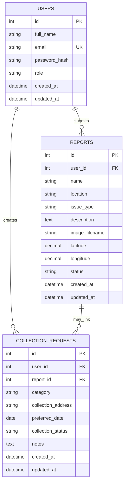

# EcoSmart – E-Waste Management System

EcoSmart is a full-stack academic project for reporting electronic-waste issues, tracking report status, and requesting collection. It combines the existing green environmental interface with a secure Flask backend, PostgreSQL database, authenticated users, protected administrator operations, analytics, and collection-request workflow.

**Developer:** Subhangi Solunke  
**Role:** Full-Stack Developer  
**Project type:** Final-Year Academic Project

> **Adaptation note:** This repository was adapted, improved, and further developed from the provided student project. The original visual direction and useful reporting features were preserved where practical; the backend, database design, authentication, security controls, documentation, and tests were substantially upgraded. No original contributor attribution or third-party license should be removed where it is legally required.

## Problem and objectives

Electronic waste is often reported inconsistently and is difficult to track after a complaint is submitted. EcoSmart provides one place for community members to submit categorized e-waste reports with images and GPS coordinates, while administrators can review, analyze, update, and remove reports. Users can also request a collection date and monitor the request status.

## Features

- Responsive environmental-themed home page, awareness content, dark mode, and collection schedule.
- Public e-waste report submission with category, description, image, and optional GPS coordinates.
- Optional account registration and login with Werkzeug password hashing.
- Authenticated users can retrieve their own reports and create/view collection requests.
- Server-protected administrator dashboard for searching, filtering, viewing images/GPS, updating status, deleting reports, exporting visible reports to PDF, and viewing live statistics.
- PostgreSQL persistence through Flask-SQLAlchemy and Flask-Migrate.
- Secure upload handling: allowed image extensions, 5 MB limit, randomized names, and deletion cleanup.
- CSRF checks for state-changing API operations, environment-based secrets, safe DOM rendering, and production-safe debug defaults.

## Technology stack

- Python 3.11+
- Flask 3, Flask-SQLAlchemy, Flask-Migrate, Flask-Login
- PostgreSQL with Psycopg 3
- HTML5, CSS3, vanilla JavaScript, Chart.js
- Pytest

## Architecture

The Flask application serves the existing static frontend and JSON APIs. SQLAlchemy models represent `users`, `reports`, and `collection_requests`. Flask-Login manages sessions; authorization is checked on the server for every administrator API route. The browser requests a CSRF token before changing state.



## Project structure

```text
app.py                         Flask application and JSON routes
config.py                      Environment-based configuration
models.py                      SQLAlchemy models
run.py                         Application entry point
index.html                     Public frontend
login.html / register.html     Authentication pages
admin.html                     Protected administrator frontend
script.js / auth.js / admin.js Frontend behavior
style.css / admin.css          Existing design and improvements
migrations/                    Flask-Migrate metadata and initial revision
tests/                         Pytest suite
docs/                          Setup, API, audit, and learning guides
.env.example                   Safe configuration template
```

## Windows setup

The beginner-friendly guide is in [docs/WINDOWS_SETUP.md](docs/WINDOWS_SETUP.md). The short version is:

```powershell
py -m venv venv
.\venv\Scripts\Activate.ps1
python -m pip install --upgrade pip
pip install -r requirements.txt
copy .env.example .env
```

Install PostgreSQL from the official PostgreSQL website, then create the databases in `psql`:

```sql
CREATE USER ecosmart_user WITH PASSWORD 'choose-a-password';
CREATE DATABASE ecosmart OWNER ecosmart_user;
CREATE DATABASE ecosmart_test OWNER ecosmart_user;
```

Edit `.env` and replace the password in `DATABASE_URL` and `TEST_DATABASE_URL`. Do not commit `.env`.

Run migrations and create an administrator securely:

```powershell
$env:FLASK_APP = "app.py"
flask db upgrade
flask create-admin
python run.py
```

Open `http://127.0.0.1:5000/`. A public user cannot register as an administrator; the CLI command is the supported admin-account setup path.

## Testing

Run:

```powershell
pytest -q
```

The test suite uses a separate `TEST_DATABASE_URL` when PostgreSQL is configured. If it is not configured, the application tests use an isolated in-memory SQLite database for route and validation coverage. PostgreSQL-specific migration verification still requires a local PostgreSQL installation.

## API documentation

The endpoint reference is in [docs/API.md](docs/API.md). Important routes include `/api/auth/register`, `/api/auth/login`, `/api/reports`, `/api/stats`, `/api/admin/reports`, `/api/collections`, and `/api/admin/collections/<id>`.

## Screenshots

The original project screenshots are retained under `screenshots/`. They are reference images from the supplied project, not claims of a newly deployed application.

## Troubleshooting and deployment

See [docs/WINDOWS_SETUP.md](docs/WINDOWS_SETUP.md) for PostgreSQL, migration, port, upload, and login troubleshooting. For deployment, set a strong `SECRET_KEY`, a managed PostgreSQL `DATABASE_URL`, `FLASK_DEBUG=false`, an absolute writable `UPLOAD_FOLDER`, and HTTPS with `SESSION_COOKIE_SECURE=true`. Do not use the development server as a production process.

## Future improvements

Email notifications, a richer collection scheduling interface, pagination, audit logging, password reset, and deployment-specific object storage can be added later without changing the core report model.

## GitHub upload

See [docs/GITHUB_UPLOAD.md](docs/GITHUB_UPLOAD.md). Do not upload `.env`, uploaded images, database dumps, or private data.
